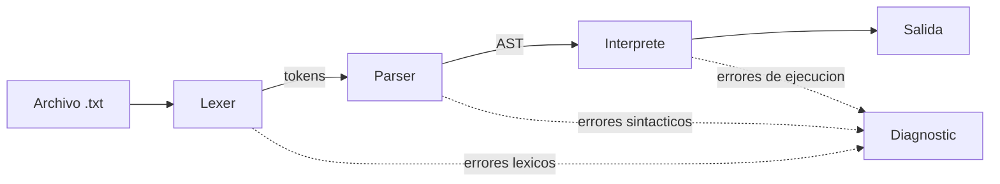

# Cafeto 


**Cafeto** es un mini lenguaje de programación con vocabulario cafetero. Su lexer, su parser
y su intérprete están escritos a mano en Swift, sin generadores de código ni dependencias externas.
Nació como proyecto de *Procesadores de Lenguajes* y demuestra el ciclo completo:
análisis léxico → análisis sintáctico → ejecución.

## Características

- Tipos: enteros, reales, strings y booleanos
- Variables, aritmética con precedencia, relacionales, lógicos y concatenación
- Condicionales (`if / else if / else`), `while`, `for`, `break` y `continue`
- Funciones con parámetros, retorno y recursión
- Arreglos de una dimensión
- Clases, objetos, constructores, métodos y **herencia**
- Excepciones: `try / catch / finally`, excepciones propias y errores de ejecución atrapables
- Errores léxicos, sintácticos y de ejecución, siempre con número de línea

## Un vistazo al lenguaje

```text
# Hola, Cafeto
sembrar kilos brota 20
catar kilos amargo 5:
    servir("Hay café de sobra")
ristretto:
    servir("Toca comprar más")
empacar
```

| Cafeto | Equivalente en Swift |
|---|---|
| `sembrar` / `brota` | `var` / `=` |
| `catar` / `macchiato` / `ristretto` | `if` / `else if` / `else` |
| `colar` / `recolectar … vivero … taza` | `while` / `for … in a...b` |
| `receta` / `entregar` | `func` / `return` |
| `finca` / `semilla` / `plantar` / `cafetal` | `class` / `init` / constructor call / `self` |
| `preparar` / `derrame` / `lavar` / `volcar` | `do` / `catch` / `defer` (aprox.) / `throw` |
| `servir` / `barista` | `print` / `readLine` |
| `empacar` | fin de bloque (`}`) |

Referencia completa, tabla léxica y gramática EBNF en [`docs/language-reference.md`](docs/language-reference.md).

## Inicio rápido

Requisitos: Swift 5.9 o superior.

```bash
git clone https://github.com/DajumaKs/cafeto-lang.git
cd cafeto-lang
swift build -c release
swift run cafeto examples/01_condicionales.txt
```

Opciones de la línea de comandos:

```text
cafeto [opciones] <archivo.txt>
  -q, --no-tokens   No imprime la lista de tokens
  -h, --help        Muestra la ayuda
```

Por defecto el programa imprime los tokens (`[line 1] KW_SEMBRAR sembrar`), luego la salida del programa.

## Manejo de errores

```text
Lexical error on line 2: unrecognized symbol '@'
Syntax error on line 3: expected 'empacar' to close the block opened on line 2
Runtime error on line 4: division by zero
```

## Arquitectura



## Estructura del proyecto

```text
Sources/
  CafetoCore/   Token, Lexer, AST, Parser, Value, Environment, Interpreter, CafetoEngine
  cafeto/       Ejecutable de línea de comandos
Tests/          Pruebas unitarias (XCTest)
examples/       Programas .txt: uno por requisito, más archivos con errores
docs/           Referencia del lenguaje y gramática
```

## Pruebas

```bash
swift test
```

Los programas de `examples/` cubren condicionales, ciclos, funciones, arreglos, clases, excepciones,
entrada por teclado, operadores y los tres tipos de error.

## Decisiones de diseño

- Los bloques se abren con `:` y se cierran con `empacar`; un `if/else if/else` o un `try/catch/finally` lleva un solo `empacar`.
- División entera para `entero / entero`, igual que Swift.
- Las condiciones deben ser booleanas (error de tipos en ejecución si no).
- Las funciones y clases de primer nivel se registran antes de ejecutar, así que pueden usarse antes de su definición.
- Los errores de ejecución se pueden atrapar con `derrame` como texto.

## Hoja de ruta

- [ ] do-while y switch
- [ ] Análisis semántico estático
- [ ] Editor gráfico con paneles de tokens, errores y salida

## Autor

**Josue Daniel Castaño Montoya** · [@DajumaKs](https://github.com/DajumaKs)
Ingeniería de Sistemas, Universidad Autónoma de Manizales

## Licencia

MIT, ver [LICENSE](LICENSE).
